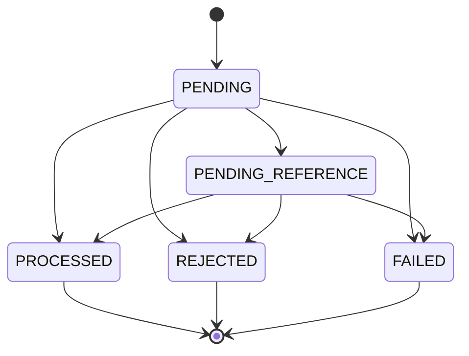

# Decisões de engenharia para estudo

Este documento explica o desenho e o que já foi comprovado. O enunciado integral está no README e a arquitetura detalhada em ARCHITECTURE.md. Nenhuma decisão proposta equivale a uma garantia implementada.

## 1. Testes acompanham a implementação

**Decisão implementada:** domínio com testes unitários desde o início; infraestrutura com PostgreSQL e LocalStack reais. Evita descobrir erros de escala, aritmética ou transição somente depois de conectar os workers. Mocks não provariam locks, constraints nem redrive do broker.

**Evidência:** Money, Wallet, ledger e WagerTransaction testados; suíte de infraestrutura com rollback e DLQ reais no emulador. **Limite:** nenhuma dessas provas substitui testes financeiros multiprocesso. Comandos em MANUAL_TESTS.md.

## 2. Money é um valor exato e imutável

**Decisão implementada:** decimal.js, entradas string, resultados com duas casas e limite compatível com numeric(20,2). Normalizar 1.2 para 1.20 é aceito; 1.234 é rejeitado sem arredondamento. Aritmética interna admite sinal para diferença/reversão; entrada financeira não admite negativo.

**Alternativa:** centavos em bigint também dariam precisão exata, com mapeamento explícito. Decimal foi escolhido pela proximidade com os contratos e PostgreSQL. **Custo:** cuidar da precisão configurada e impedir conversão do driver para number. Código numérico de porta/versão/timestamp não representa dinheiro.

**Atualizado:** Money.rehydrate assinado implementado; preparação pública aceita BRL. Money valida formato de moeda, sem catálogo completo ISO-4217.

## 3. Domínio separado do framework e banco

**Decisão implementada:** entidades sem decorators NestJS/MikroORM, construídas por factories. `create`/`open` validam novas operações; `rehydrate` apenas reconstrói estado confiável, sem debitar novamente ou reaplicar transições. Dates são copiadas para evitar mutação externa.

**Custo:** mapeadores explícitos e mais código entre domínio e persistência. **Benefício:** regras podem ser estudadas e testadas sem subir API ou banco. Rehydrate nunca deve receber payload público diretamente.

## 4. Movimento retorna ledger antes de mudar estado

**Decisão implementada:** Wallet.debit/credit validam o lançamento antes de atualizar balance/version/updatedAt. Se moeda, valor, saldo ou contexto forem inválidos, a wallet fica intacta. Abertura positiva exige identidade da transação OPENING e retorna crédito; abertura zero não gera lançamento. Versão começa em 1 e só cresce quando o saldo muda.

**Limite:** a entidade não persiste, não faz lock e não deduplica chamadas. O caso de uso deverá guardar wallet, transação, ledger e outbox no mesmo commit. Ledger em memória está congelado; proteção SQL append-only implementada e testada em schema isolado.

## 5. WagerTransaction encapsula transições

**Decisão implementada:** estados terminais não transitam. Factory pública rejeita OPENING; factory interna separada o permite. LOSS exige zero e não tem direção de ledger. Reversões exigem valor integral igual à referência. WIN com referência pode ter payout diferente da BET.

Reagendar PENDING_REFERENCE mantém o estado; não representa uma nova aceitação nem deve gerar outro evento de entrada. Referência ausente/pendente gera sinal para o futuro caso de uso aguardar. Referência terminal rejeitada/falha é incompatível e leva à rejeição auditável pelo caso de uso. A entidade não executa retries nem escolhe status HTTP.

**Limite:** markProcessed valida referência e estado, mas não confirma existência de débito/ledger no banco; essa ligação será garantida pela transação SQL e schema. Persistência do resultado e replay concorrente agora implementados nos casos de uso.

## 6. Reversões têm regras específicas

**Implementado no domínio:** referência do mesmo provider/player/wallet/moeda/rodada; REFUND somente BET; ROLLBACK de BET é crédito e de WIN/REFUND é débito. Não permitir referência a LOSS, OPENING ou outro ROLLBACK. Reversão que debita além do saldo usa código distinto de aposta sem saldo.

**Interpretação registrada:** unicidade é por (referência, tipo), conforme enunciado: REFUND e ROLLBACK da mesma BET podem coexistir, embora tenham implicações financeiras que merecem alinhamento em produção. A constraint única parcial está implementada e testada na migration inicial. A entidade isolada não sabe se outra transação já reverteu a referência.

## 7. Lock por wallet e schema como garantia final

**Proposta:** pessimistic lock de linha no PostgreSQL, sem lock global. Após o lock, validar saldo e atualizar wallet/ledger/transação/inbox/outbox em uma transação. Wallets diferentes podem avançar em paralelo; uma wallet muito disputada serializa e pode aumentar latência.

**Alternativas:** optimistic locking com retry ou update condicionado. São válidas, mas exigem tratamento adicional de conflito. **Atualizado:** implementação e provas com três processos, 50 duplicatas e duas BET de 80 sobre saldo 100 concluídas. FIFO sozinho não protege o endpoint HTTP nem substitui constraints.

## 8. Inbox e outbox dão recuperação sem prometer publicação única

**Proposta:** inbox deduplica (consumerName, messageId), identidade financeira deduplica o comando e outbox guarda evento no commit financeiro. Ack SQS só depois de commit. Publicação ocorre depois, com lease recuperável e eventId estável.

Se o processo morrer depois de publicar e antes de marcar publishedAt, outra instância pode publicar de novo. Consumidor precisa deduplicar. Não há transação única envolvendo PostgreSQL e SQS; o compromisso é at-least-once com efeitos financeiros idempotentes.

**Já validado:** transporte FIFO/redelivery/DLQ e outbox financeira persistida no commit. **Pendente:** inbox financeira, workers, crash entre commit/ack e publishers concorrentes.

## 9. Migrations reversíveis e testes isolados

**Implementado:** MikroORM 6.6.17 com conexão explícita e runner up/down/pending; teste up/down/up com migration de prova em schema único. Sem schema sync automático no startup. **Custo:** DDL, índices e triggers exigem revisão e testes próprios.

**Atualizado:** migration financeira real e permissões/constraints já validadas em schema isolado. Aplicação ao public e provisionamento de runtime persistente ainda pendentes. Reversibilidade de uma migration vazia de negócio não prova rollback seguro de dados históricos; produção exigiria plano e backup adequado.

## 10. Escopo de entrega

**Proposta:** adiar IdP, dashboard, double-entry e carga até concluir garantias obrigatórias. O ledger solicitado é de entradas de débito/crédito por wallet; não anunciar partidas dobradas. Autenticação adiada exige extensão explícita e uso local documentado quando implementada.

O plano é sequencial e não tem datas definidas. Não há evidência para estimar throughput ou declarar correção distribuída completa. PROJECT_STATUS.md registra exatamente o que foi executado.

## 11. Eventos como snapshots e hash como contrato estável

**Implementado:** quatro subclasses de IntegrationEvent, version=1 e snapshots JSON imutáveis. Todas usam aggregateId=walletId e recebem eventId do contexto. Não gerar um novo ID ao serializar permite futura republicação idempotente. A factory confere estado da fonte; não comprova que houve commit.

**Implementado:** normalizador de negócio compartilhado entre preparação HTTP/SQS, SHA-256 de JSON ordenado e dinheiro normalizado. Sem metadados no hash. O contrato público foi reduzido a BRL; evita aceitar códigos arbitrários enquanto o domínio Money mantém verificações multi-moeda. Não há trim silencioso nem normalização Unicode de IDs.

**Alternativas e custo:** usar canonicalização genérica como RFC 8785 traria uma especificação mais ampla. O contrato atual só contém strings/objetos e usa algoritmo restrito documentado, com vetor conhecido independente. Mudar normalização após persistir hashes exige compatibilidade explícita. Eventos copiados/congelados custam alocação, em troca de impedir que alterações posteriores na entidade mudem payloads já produzidos.

**Atualizado:** chaves e envelopes persistidos no commit financeiro; adaptação HTTP/SQS ainda pendente. Detalhes, exemplos e limites em [EVENTS_AND_HASH.md](EVENTS_AND_HASH.md).

## 12. Schema, precisão e garantias no commit

**Implementado e testado:** cinco tabelas, numeric exato com CHECKs, mapeadores, FKs/UNIQUE e triggers de consistência adiados até o commit. Conferir saldo agregado não basta: validar também cadeia dos saldos intermediários, versão e correspondência de cada operação com seu lançamento.

**Mudança da proposta inicial:** numeric(20,2) arredondaria entradas com mais casas antes do CHECK. Numeric sem typmod com scale <= 2 e magnitude limitada rejeita escala excedente sem arredondamento. Leitura do driver normaliza somente strings válidas; números JS são rejeitados. [Motivo e referência oficial](FINANCIAL_SCHEMA.md).

**Trade-off:** agregação/janela por wallet a cada disparo custa mais conforme o ledger cresce. Nenhuma meta de throughput foi medida; correção vem primeiro. Locks do schema serializam a wallet; futuros casos de uso seguem wallet antes de reservar transação. A sequência anterior foi revista antes de existir serviço financeiro.

**Permissões:** grants para papel não proprietário e triggers complementam a imutabilidade. Conta local do Compose é administrativa; runtime role persistente não foi provisionado ainda. A migration foi testada em schema exclusivo; public e dados de desenvolvimento permanecem sem aplicação desta migration.

**Limite:** schema não sabe se result_snapshot contém a resposta HTTP correta ou se o publisher publicou depois do commit. Esses comportamentos continuam responsabilidades do caso de uso e dos workers, com testes específicos por implementar.

## 13. Unidade transacional e replay histórico

**Implementado:** OpenWallet e ProcessWagerTransaction dependem de uma porta, com adaptador MikroORM por operação. Saldo é lido sob lock, identidades são reconsultadas e a resposta terminal é persistida no commit com ledger e outbox. Replay não recalcula saldo atual e não gera novo evento. UNIQUE resolve races que escapam da consulta inicial; retry reabre a transação por inteiro.

**Decisão:** quatro tentativas no máximo para conflitos SQL recuperáveis, sem chamadas externas no callback. Rejeição de negócio vira registro/evento; falha de infraestrutura desfaz o conjunto e propaga. Atualizar somente campos mutáveis protege identidade e precisão original dos timestamps.

**Mudança de taxonomia:** BALANCE_LIMIT_EXCEEDED impede tratar crédito acima da capacidade como falha inesperada. Nova migration estende o CHECK sem editar a primeira. Rollback que invalidaria auditoria é recusado, nunca apaga dados para concluir.

**Evidências:** 50 duplicatas, duas BETs disputando saldo, lock de wallet independente e três processos Bun com barreira de início. Replay histórico foi conferido em processos novos após outros movimentos. Nenhum benchmark foi feito.

**Pendente:** integração HTTP e workers, inbox na mesma sessão, publicação com lease, crash entre commit/ack e publishers concorrentes. Resume é entrada explícita e não um agendador. [Detalhes e comandos](FINANCIAL_PROCESSING.md).

## 14. HTTP fino, cursor exato e snapshot de reconciliação

**Implementado:** controllers delegam regras financeiras aos casos de uso; contratos explícitos rejeitam campos/tipos inválidos e retornam códigos distintos para conflito, rejeição, pendência e infraestrutura. Erros não expõem SQL ou texto interno. ProviderIdentityPort/guard deixam extensão para IdP; modo local é declarado e não aceito em produção.

**Cursor:** armazenar texto UTC com microssegundos no cursor, em vez de converter para Date, preserva a posição real no PostgreSQL. Base64url é formato opaco, não criptografia ou autorização. Wallet/version/formato são validados e limite máximo é 100.

**Reconciliação:** REPEATABLE READ evita comparar saldo de um commit com ledger de outro. Divergência gera resposta/log/métrica e não é corrigida silenciosamente. A métrica é por processo, independente da idempotência persistente.

**Startup:** rotas financeiras exigem ativação explícita, schema migrado e papel não proprietário/administrativo. Não criar usuários ou migrar no startup. Testes usam papel/schema temporários; runtime persistente permanece pendente.

**Evidência:** 14 testes HTTP, inclusive microssegundos, concorrência com reconciliação e falha transitória simulada sem parar containers. Suíte completa: 163 testes/589 assertions. [Guia HTTP e comandos](HTTP_API.md).

## 15. Inbox na mesma sessão e leases com token

**Implementado:** inbox opcional dentro de ProcessWagerTransaction.execute, usando a mesma FinancialSession de wallet/ledger/outbox. Separar consumerName/messageId do identificador financeiro preserva duas garantias: redelivery do envelope e replay do comando em nova mensagem.

**Hash de transporte:** inclui envelope completo, inclusive key/timestamp, sem atributos mutáveis do SQS. Mudança de key no mesmo messageId conflita na inbox, mesmo que o hash financeiro seja igual. Não usar somente hash de negócio na inbox.

**Publisher:** claim curto com SKIP LOCKED, envio fora da transação, lease renovável e confirmação por token. Publicação exatamente uma vez não foi prometida: crash após send pode duplicar; mesmo eventId permite dedup persistente downstream. Teste Standard expõe duplicata que FIFO poderia esconder.

**DLQ:** somente apagar a origem depois da confirmação do envio; falha de DLQ preserva origem. Diagnóstico em atributos seguros, sem SQL/texto livre. Tentativa sem commit não vira FAILED fictício quando o banco falha.

**Shutdown:** drenar até prazo; ao expirar, devolver visibilidade/posse e impedir ack/marcação tardios. Coordenar heartbeat em andamento evita cancelar a liberação com renovação atrasada.

**Evidências:** 17 testes novos, com SIGKILL real após commit/antes de ack e após envio/antes de marcação. Suíte total 180 testes/680 assertions. Scheduler automático, métricas completas e preparação operacional ainda pendentes. [Guia e comandos](MESSAGING.md).

## 16. Scheduler sem inversão de locks

**Implementado:** nova reference_jobs coordena claims sem atualizar a transação financeira. Claim curto trava somente job; aplicação trava wallet e depois valida/trava o token do job. Evita a inversão causada pelos triggers que travam wallet ao atualizar wager_transactions. Rejeitar token expirado protege contra processo atrasado.

**Trade-off:** tabela adicional e jobs concluídos retidos. A descoberta percorre pendências; medir antes de otimizar. Lease expirado permite recuperação sem reiniciar TTL, cursor ou identidade. Liberação com SKIP LOCKED respeita deadline sem bloquear numa aplicação financeira ainda em andamento.

**Evidências:** dois schedulers, SIGKILL após claim, dono antigo, TTL e entrada operacional com login restrito/SIGTERM. [Guia](REFERENCE_SCHEDULER.md).

## 17. Telemetria por processo e estado durável

**Implementado:** logs JSON filtrados e métricas com categorias finitas. IDs ficam em logs, não labels. Resultados financeiros são contados após commit; retries/locks são medidos na tentativa real. Falha do sink de logs não modifica a transação.

**Decisão:** counters/histograms por processo; gauges consultam banco/SQS e restauram visibilidade após reinício. Uma falha de coleta preserva a última amostra e indica indisponibilidade, em vez de inventar zero saudável. Não somar gauges globais repetidos por vários alvos.

**Trade-off:** agregações SQL custam leitura por scrape e registry local reseta. Não usar telemetria como ledger nem dedup. A implementação Prometheus específica evita dependência adicional e tem testes de cardinalidade/formato. OTel/dashboard continuam opcionais.

**Evidências:** timeout real de lock e retry, métricas de entrega com SQS, coleta após registry novo, fonte indisponível, endpoints e logs sem payload financeiro. [Guia](OBSERVABILITY.md).
